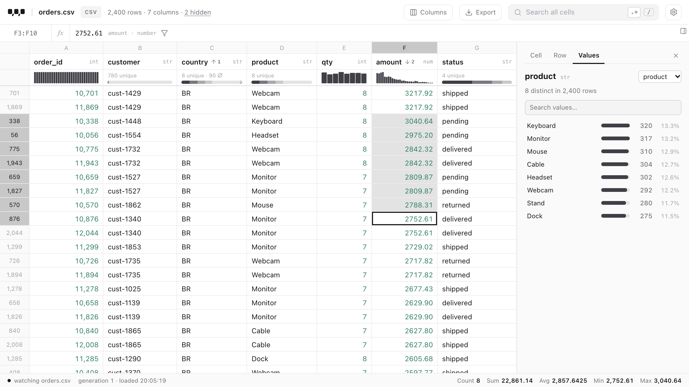

# xxsv

xxsv shows a CSV, TSV, LTSV or JSONL file as a table in your browser and keeps it up to date while you edit the file.

<p align="center">
  <picture>
    <source media="(prefers-color-scheme: dark)" srcset="docs/screenshot-dark.png">
    <source media="(prefers-color-scheme: light)" srcset="docs/screenshot-light.png">
    
  </picture>
</p>

Run `xxsv data.csv` and a page opens with the table. Save the file in your editor, and the page reloads it in place: the sort, the filters, the search and the scroll position stay, and the cells that changed glow for a moment.

The name, xxsv (ex-ex-es-vee), stands for eXtended [xsv](https://github.com/BurntSushi/xsv), the CSV toolkit. What xsv's commands do on the command line, selecting columns, sorting, searching, counting values, slicing, xxsv does in the browser, on any separator and on LTSV and JSONL too, while the file changes. It is a separate tool, not a successor to xsv.

## Features

- Follows the file. Every save reloads the table without losing your place. Changed cells and added rows are highlighted, and the status bar says what changed ("3 changed, 2 added, 1 removed").
- Large files. The server holds the table and the page fetches only the rows in view, so a file of a million rows scrolls, sorts and filters without loading the browser.
- Spreadsheet-like. Select cells, ranges, whole columns or rows with the mouse or the arrow keys, copy it, and see the count, sum, average, minimum and maximum of the range.
- A distribution for every column. A histogram or the top values sit under each column name; click one for statistics and filters.
- Columns. Hide columns and drag them into another order, and sort by several columns at once.
- Search and filter with plain text or regular expressions (RE2), across all cells or in one column. A column's filter picks its condition, like Notion: is, is not, contains, does not contain, starts with, ends with, matches a regular expression or not, and between or not between for numbers and dates.
- Values. List every value of a column with its count, most frequent first, and filter by one with a click.
- Rows. Show the selected row with every column on its own line, the hidden ones too.
- Export what you see, every matching row in the shown columns and order, as CSV, TSV or JSONL.
- Types. Each column is read as integer, number, date, datetime, boolean, string or JSON, so numbers sort as numbers and dates filter by range. Missing cells and cells that do not fit the column's type are told apart and can be filtered.
- Long values. JSON and long text open in a popover next to the cell, pretty-printed, or in a side panel.
- Images. A cell that holds the path of an image file, or a `data:` image, shows it small beside the text; point at it for a larger one. Images on the web are not loaded.
- One binary, local only. The UI is built in, and the page talks to nothing but xxsv on 127.0.0.1.

## Install

With [Homebrew](https://brew.sh/):

```sh
brew install babarot/tap/xxsv
```

With [Nix](https://nixos.org/):

```sh
nix profile install github:babarot/nur-packages#xxsv
```

With Go:

```sh
go install github.com/babarot/xxsv/cmd/xxsv@latest
```

## Usage

```sh
xxsv data.csv
xxsv events.jsonl
xxsv access.ltsv
xxsv -p 8080 --no-open report.tsv
```

```
usage: xxsv [flags] <file>

flags:
  -p, --port N        port to listen on (default 7333; a free one if taken)
      --no-open       do not open the browser
  -n, --no-header     the first row is data; name the columns col1, col2, ...
      --header        always read the first row as the header
  -d, --delimiter C   field delimiter for CSV (a character, or "tab")
      --version       print the version
```

The format comes from the file extension (`.csv`, `.tsv`, `.tab`, `.ltsv`, `.jsonl`, `.ndjson`) or, failing that, from the content, including whether fields are separated by commas or tabs. For CSV and TSV, the first row is the header unless one of its cells is a bare number; `-n` and `--header` decide it yourself.

In the page:

| Key | Action |
|---|---|
| Arrow keys | Move the selection; with Shift, extend the range |
| Drag | Select a range of cells |
| Cmd-C, Ctrl-C | Copy the selected cells, tab-separated |
| Click a column name | Sort by that column: ascending, descending, off |
| Shift-click a column name | Add it as the next sort key, or turn its key around or off |
| Enter | Show the selected row in the side panel |
| Space, double-click | Show the full value of a long cell |
| `/` | Search all cells (`.*` beside the box for a regular expression) |
| Esc | Close a popover or a menu, leave the search |

A column's distribution, under its name, opens its statistics and filters, and from there the list of its values or hiding it. The Columns button lists every column to show, hide and move; Export writes the view to a file.

The view (search, filters, sort keys, shown columns, scroll position) is kept in the URL, so a reload of the page or a copied link opens the same view. Settings (theme, accent, number colors, digit grouping, histogram scale) are saved in the browser.

## How cells are read

xxsv looks at the first 5,000 rows of each column and picks the type that 95% of the non-missing values fit (99% for booleans):

| Type | Values |
|---|---|
| integer | `42`, `-7`, `+1` (not `007`: leading zeros mean a code, such as a postal code, and the column stays a string) |
| number | `3.14`, `.5`, `1e-3` |
| date | `2024-01-02` |
| datetime | `2024-01-02 10:00`, `2024-01-02T10:00:00Z`, `2024-01-02T10:00:00+09:00`, or as web servers log it, `10/Oct/2000:13:55:36 -0700`, in brackets or not (a column may mix dates in) |
| boolean | `true`, `false`, in any case |
| json | objects and arrays, such as nested values in JSONL |
| string | anything else |

A cell is then one of three things:

- a value of the column's type;
- missing: empty, an absent key or `null` in JSONL, an absent label in LTSV, or, in integer, number, date, datetime and boolean columns, the text `null`, `na` or `nan` (in a string column, `NA` stays a value);
- invalid: text that is not a value of the type, such as `pending` in a number column. Invalid cells are underlined in the table, counted apart from missing ones, and sort after the values.

Datetimes without a time zone are shown as written. When a column has times with zones, they are shown in UTC.

In a string column, a path that ends in `.png`, `.jpg`, `.jpeg`, `.gif`, `.webp` or `.bmp` is shown as an image when there is one. An absolute path may be anywhere; a relative one starts at the table's directory and stays inside it. The file's content must be an image of one of these types. A base64 `data:image/...` URL is shown the same way; other URLs are left as text.

JSONL lines become rows and their top-level keys become columns; [LTSV](http://ltsv.org/) lines and their labels do the same. An LTSV line with a field that is not `label:value` is skipped and counted, like a JSONL line that is not an object; the last of a repeated label counts, and escapes such as `\x22` stay as written. Files whose lines use many different keys keep the 1,000 most common as columns and fold the rest into an `(other keys)` column.

## Development

The server is Go; the UI is TypeScript in `web/`, built with esbuild into `internal/server/ui/dist`, which the binary embeds. The build output is committed so that `go install` needs no Node. After changing `web/src`, rebuild and commit the result:

```sh
cd web
npm ci
npm run build
```

Tests:

```sh
go test ./...        # server
cd web
npm test             # UI unit tests (Node's test runner)
npm run e2e          # end-to-end tests: builds the UI and xxsv, drives the page with Playwright
```

The end-to-end tests use the installed Google Chrome. Set `XXSV_E2E_BROWSER=chromium` to use Playwright's Chromium instead (`npx playwright install chromium`).

To measure a large file:

```sh
go run ./scripts/gendata 1000000 data.csv
XXSV_BENCH_FILE=data.csv go test ./internal/query -run TestQueryTiming -v
```

`npm run screenshot` in `web/` takes the pictures at the top of this file, light and dark, from generated data.

## License

[MIT](LICENSE)
